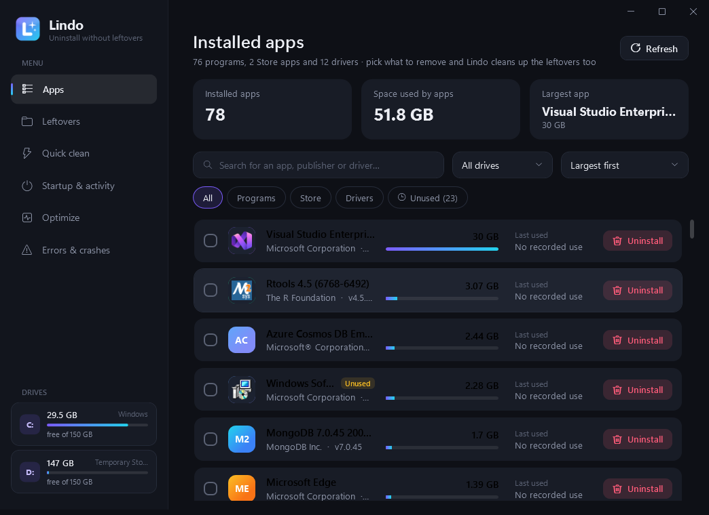
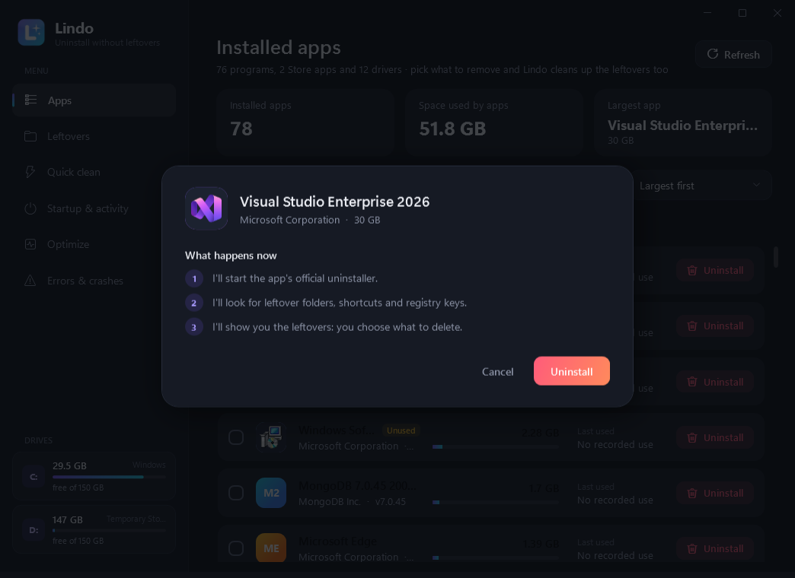
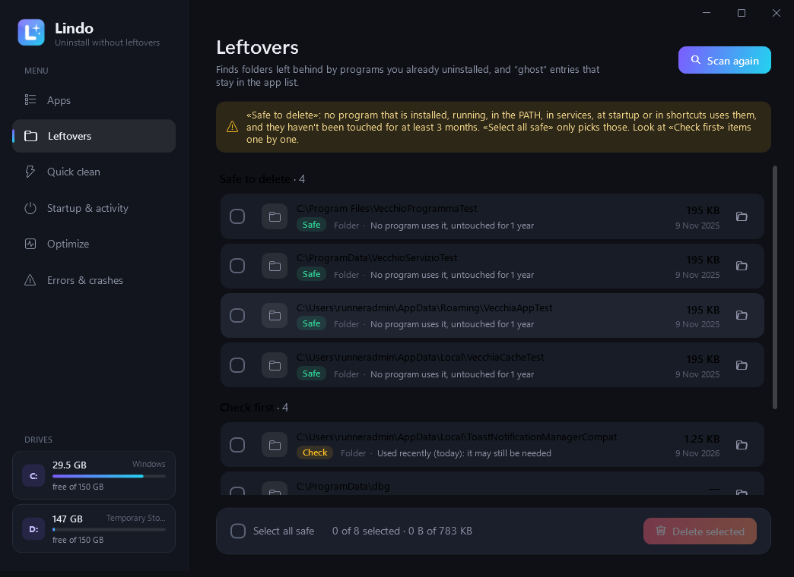
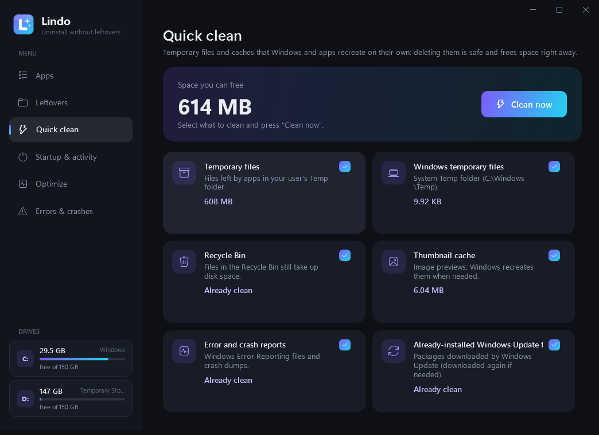
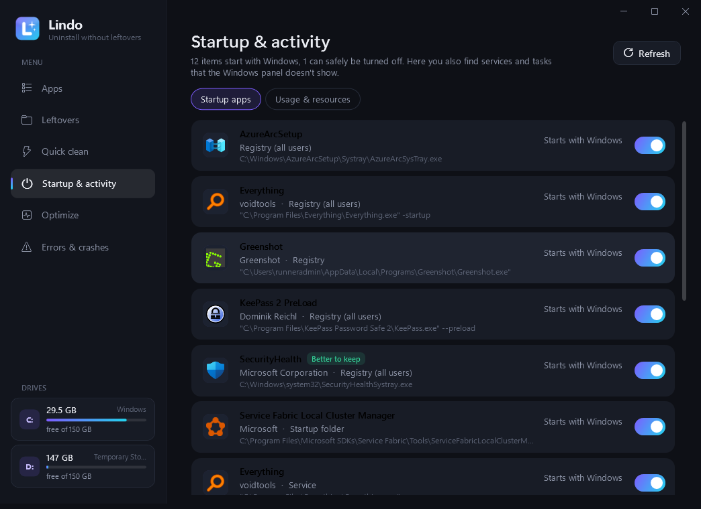
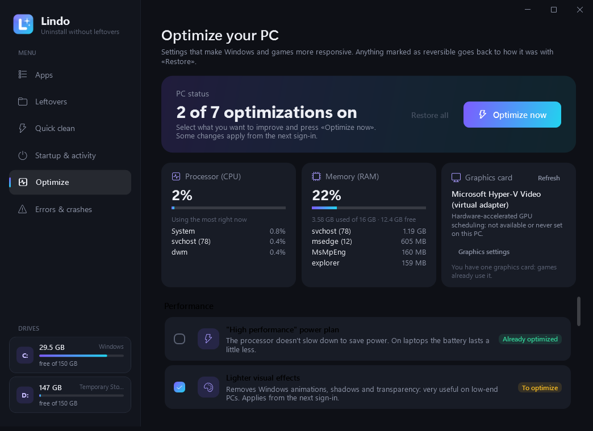
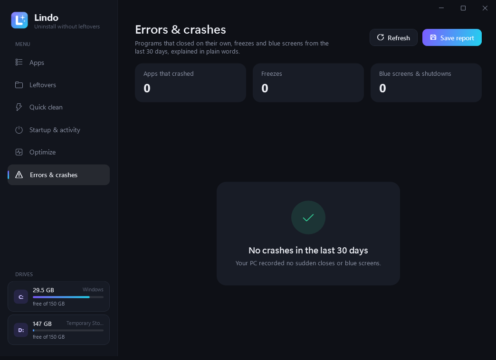
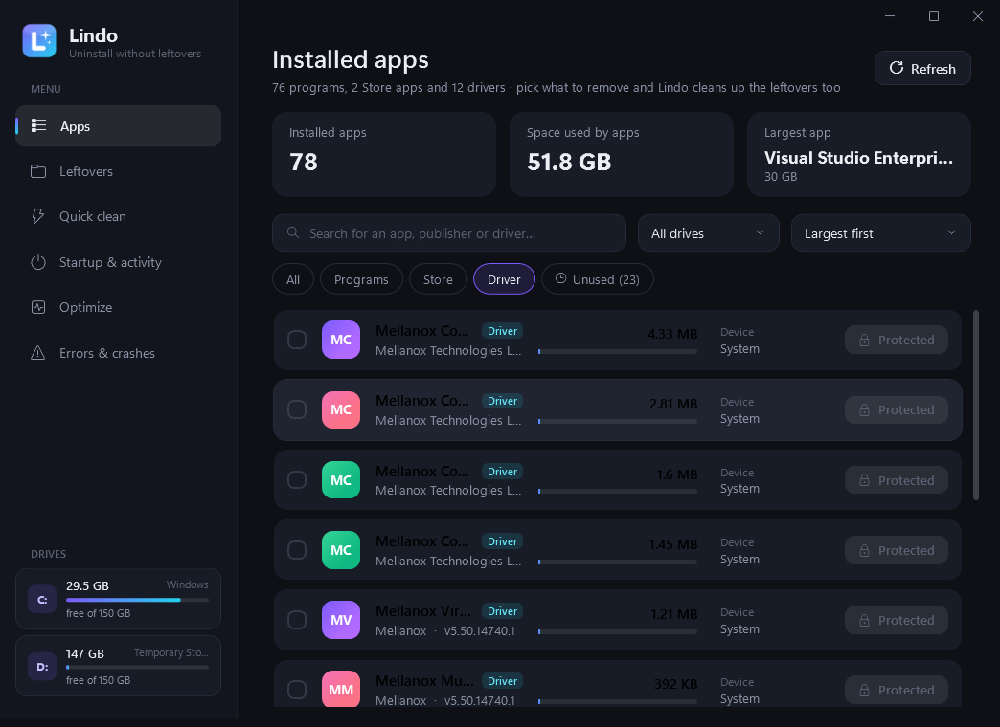

<p align="center">
  
</p>

<h1 align="center">Lindo</h1>

<p align="center">
  <b>Uninstall Windows apps without leaving anything behind.</b><br>
  See how much space every app takes, remove it in one click, and Lindo also cleans up the folders,<br>
  shortcuts and registry keys that programs leave lying around.
</p>

<p align="center">
  
  
  
  
</p>

---

## Why

When you uninstall a program on Windows, folders are often left behind in `Program Files`, `AppData`
and `ProgramData`, along with broken Start menu shortcuts and registry entries. On a nearly full drive
those leftovers add up. **Lindo** finds and removes all of it, without touching your other apps.

## Screenshots

| Installed apps | Uninstall confirmation |
|---|---|
|  |  |

| Leftovers | Quick clean |
|---|---|
|  |  |

| Startup & activity | Optimize |
|---|---|
|  |  |

| Errors & crashes | Drivers |
|---|---|
|  |  |

> The screenshots are taken automatically on a real Windows machine by
> [GitHub CI](.github/workflows/build.yml), after installing more than 20 real programs on it.

## What it does

### 📦 Apps
- All installed **programs**, **Store apps** and **drivers**, with icon, publisher, version and the
  **space they really take** (measured on disk). Sort by size, name, date or **"Least used first"**.
- **Last used** date for every app (from Windows data and Lindo's monitor) and an **"Unused"** filter:
  apps installed more than a month ago and not opened for at least two.
- **Uninstall several apps at once**: tick them and remove them together.
- **Multiple drives**: the sidebar lists every drive (C:, D:, E:…) with its free space; click one to
  see only the apps installed there.

### 🧹 Complete uninstall
1. Runs the app's **official** uninstaller (or Windows' own removal for Store apps, or `pnputil` for drivers).
2. Looks for leftovers: install folder, `AppData` / `ProgramData`, program folders on other drives,
   Start menu and Desktop shortcuts, registry keys and the entry left in the app list.
3. Also looks for **related drivers** (e.g. a printer or scanner from the same maker) and asks
   *"Do you want to delete the drivers too?"*.
4. **Final check**: scans the PC again and tells you what was deleted and how much space you got back.

### 🔍 Leftovers
Finds folders left behind on **every drive** by programs you already uninstalled, plus "ghost" entries in the
app list, split into **Safe to delete** and **Check first** (see the Safety section).

### ⚡ Quick clean
Temporary files, Recycle Bin (all drives), thumbnail cache, error reports and Windows Update files.

### 🚀 Startup & activity
- Everything that starts with Windows: registry Run keys, the Startup folder, third-party **services** and
  **scheduled tasks** (e.g. FortiClient VPN), including the ones the Windows panel doesn't show. Each one has a switch.
  Services are set to *manual start* (they only run when needed) and can be put back as they were.
- **Background monitoring** (optional): `LindoMonitor.exe` checks every 30 seconds which programs are open and
  records usage time, CPU and memory. The data stays on your PC (`%LOCALAPPDATA%\Lindo\usage.tsv`).

### 🎮 Optimize
One button, everything **reversible** with "Restore all":
- *High performance* power plan;
- no Xbox Game Bar background recording, Game Mode on;
- **mouse acceleration off** and no *Sticky Keys* popup (Shift ×5) while gaming;
- lighter visual effects (animations, shadows and transparency);
- remove unneeded apps from startup (launchers, updaters, chat, VPN…) while keeping antivirus, drivers, audio and touchpad;
- clean temporary files.

At the top of the page, **live CPU, RAM and graphics card info**:
- processor and memory usage and the programs using the most right now
  (Chrome's tabs, for example, are added together);
- graphics card name and the state of *hardware-accelerated GPU scheduling*: Lindo doesn't change it
  on its own (its effect depends on the PC), but opens the right page in Settings → Graphics;
- if the PC has **two graphics cards** (integrated + dedicated), the *Game on dedicated card…* button makes
  a game use the more powerful one, just like the same option in Settings. This is also undone by "Restore all".

### 🩺 Errors & crashes
Reads programs that closed unexpectedly, freezes, **blue screens** and sudden shutdowns from the last 30 days
out of the Windows Event Log, and explains them in plain words with what to do
(e.g. *"The crash happens in the NVIDIA graphics driver: update the NVIDIA driver"*). You can save a report to a file.

## Safety: how it avoids deleting anything else

Every deletion goes through several checks, written to be cautious and verified by automated tests
**and on real Windows with more than 20 programs installed**:

- **Only inside program folders**: `Program Files`, `Program Files (x86)`, `ProgramData`, `AppData`, Start menu, Desktop
  and program folders on other drives. Never in `Windows`, never drive roots, never Documents, Downloads, Pictures…
- **"Safe" leftovers only when no evidence says otherwise**. A folder is NEVER marked safe if:
  - it belongs to an installed app or its publisher (e.g. `Google` containing Chrome and Drive);
  - it's in the `PATH` or an environment variable (npm, Python, Android SDK, Java…);
  - it holds a service, a startup program, a registered program or a program **running right now**;
  - it's the target of a shortcut in the Start menu, on the Desktop or on the taskbar;
  - it was modified in the last 3 months or used recently according to the monitor;
  - it belongs to a well-known tool that doesn't show up as an app (npm, pip, Claude Code, Docker, Git, VS Code, Steam…);
  - it belongs to a hidden Windows component (SDKs, runtimes…).

  That's why **"Select all safe"** is safe to use: everything else stays in *Check first*.
- **Protected drivers**: graphics, network, disks, chipset, audio, USB, keyboard and mouse drivers can't be removed.
- **Registry backup**: before deleting a key Lindo saves a `.reg` backup in
  `%LOCALAPPDATA%\Lindo\Registry backup` (double-click it to restore). System keys are off-limits.
- **Reversible optimizations**: original values are saved in `%LOCALAPPDATA%\Lindo\ottimizzazioni-originali.tsv`.
- Symbolic links and junctions are never followed. Everything is logged in `%LOCALAPPDATA%\Lindo\lindo.log`.

## Tested like a real user

On every change, GitHub CI installs Lindo and more than 20 real programs on a clean Windows machine, then a
**robot drives Lindo's interface with the real mouse and keyboard** ([tests/gui/robot.ps1](tests/gui/robot.ps1)):
it uninstalls VLC, then 7-Zip and Notepad++ together (answering their uninstall wizards), deletes the "safe"
leftovers, optimizes and restores the PC, turns a startup app off and on, and checks that a deliberately crashed
program shows up explained. After each step it checks the real system, and at the end it verifies that every other
program, npm, Claude and Git are still intact. Step-by-step photos and the report are in [docs/test-robot](docs/test-robot).

## Installation

### ⬇️ Download

- **[Lindo-1.2.0.msi](../../raw/HEAD/download/Lindo-1.2.0.msi)**: installer (recommended)
- **[Lindo-1.2.0-portable.zip](../../raw/HEAD/download/Lindo-1.2.0-portable.zip)**: portable version (Lindo + monitor)
- **[Lindo.exe](../../raw/HEAD/download/Lindo.exe)**: just the app, without the background monitor

The same files are also on the [Releases](../../releases/latest) page.

| File | When to use it |
|---|---|
| `Lindo-x.y.z.msi` | Classic install: Start menu and Desktop shortcuts, shows up in installed apps. |
| `Lindo-x.y.z-portable.zip` | Full portable version: extract and run `Lindo.exe`. |
| `Lindo.exe` | Just the app (without the background monitor). |

Lindo asks for administrator rights at startup: they're needed to uninstall programs and clean
`Program Files` and `ProgramData`.

**Requirements:** Windows 10 (version 1903 or later) or Windows 11. It uses .NET Framework 4.8, which is already
included in these Windows versions ([Microsoft Learn](https://learn.microsoft.com/dotnet/framework/install/guide-for-developers)),
so there's nothing else to download and the installer is under **500 KB**.

> Windows SmartScreen may show "Windows protected your PC" because the executable isn't digitally signed:
> click **More info → Run anyway**.

## Building it yourself

You need the [.NET 8 SDK](https://dotnet.microsoft.com/download) (the official Microsoft one) and, for the MSI, `wixl`
(the `wixl` package on Ubuntu/Debian). It also works on Linux:

```bash
./build.sh
```

The files end up in `dist/`. On Windows, `dotnet build src/Lindo -c Release` is enough.

Command-line options, useful for testing:

```bash
Lindo.exe --selftest report.txt      # reads real apps and leftovers, checks the safety rules, deletes NOTHING
Lindo.exe --screenshot folder        # saves screenshots of the interface and exits
Lindo.exe --safety-test report.txt --expect "C:\\folder;..."   # checks that the "safe" leftovers are only the expected ones
Lindo.exe --test-uninstall report.txt --apps "VLC;7-Zip"       # really uninstalls and checks that everything else is intact
```

## Project structure

```
src/Lindo.Core/        pure logic (leftover detection, safety rules) — unit tested
src/Lindo/             WPF app: UI, registry reading, uninstall, cleanup, startup, optimization, crashes
src/Lindo.Monitor/     LindoMonitor.exe: lightweight app-usage monitor (optional)
tests/Lindo.Core.Tests automated tests (xUnit)
tests/gui/robot.ps1    robot that uses the real interface on Windows and checks the system
installer/Lindo.wxs    MSI installer definition
assets/                icon and logo (regenerate with assets/make_icon.py)
```
