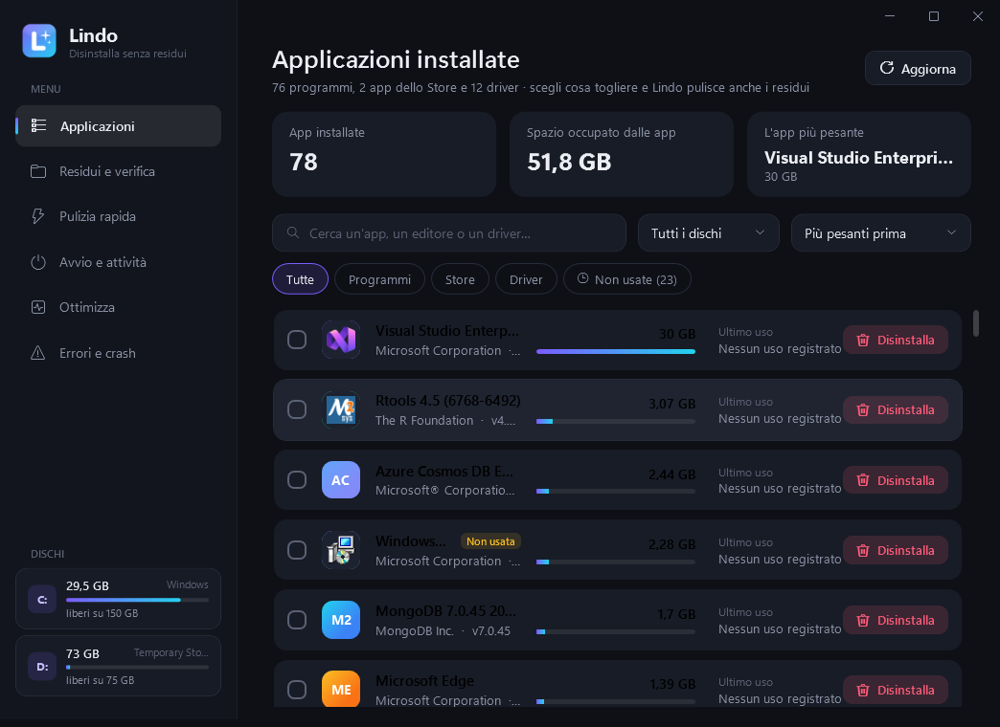
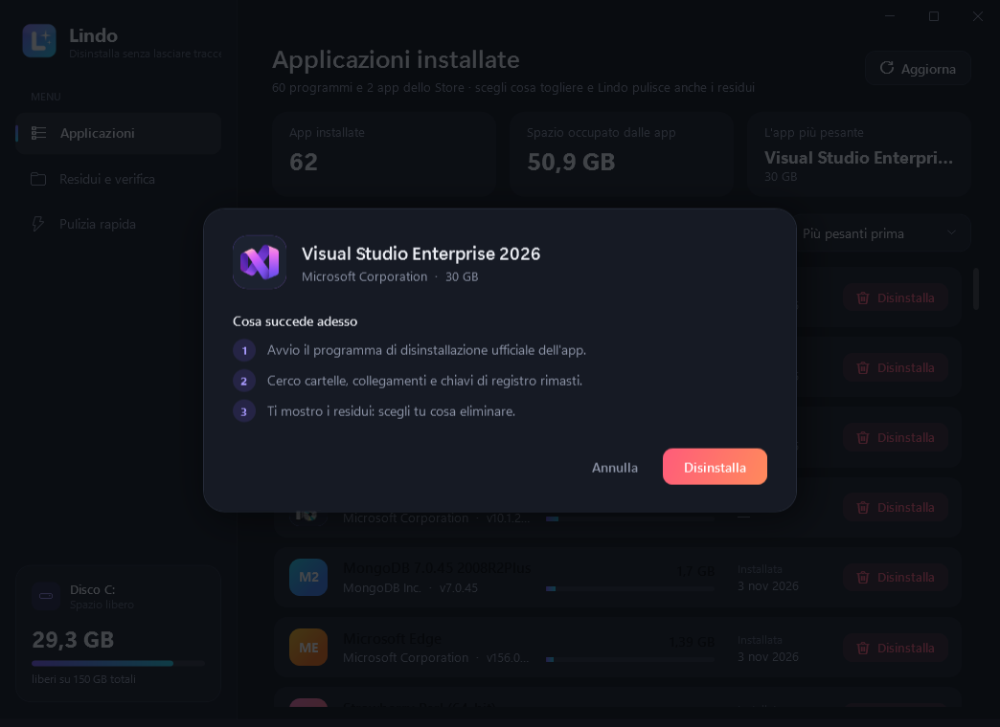
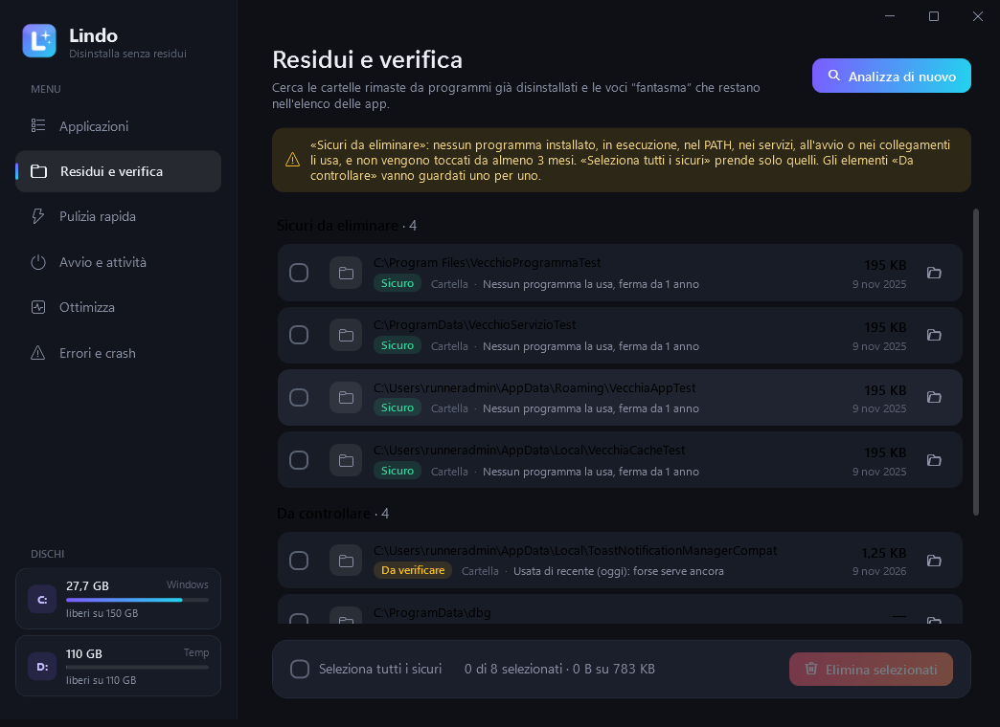
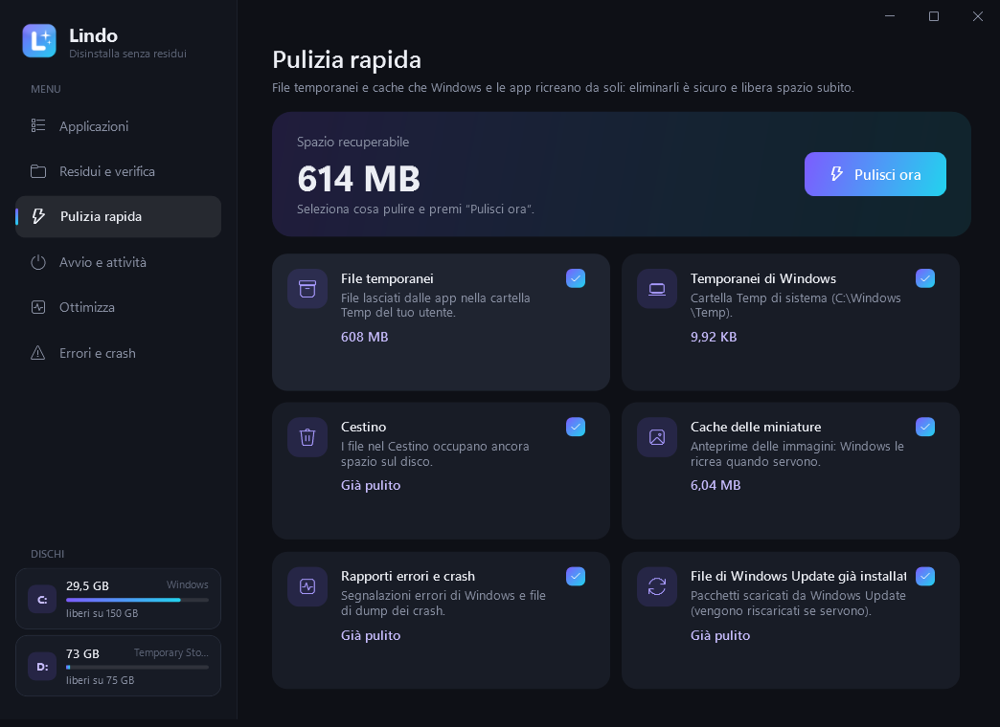
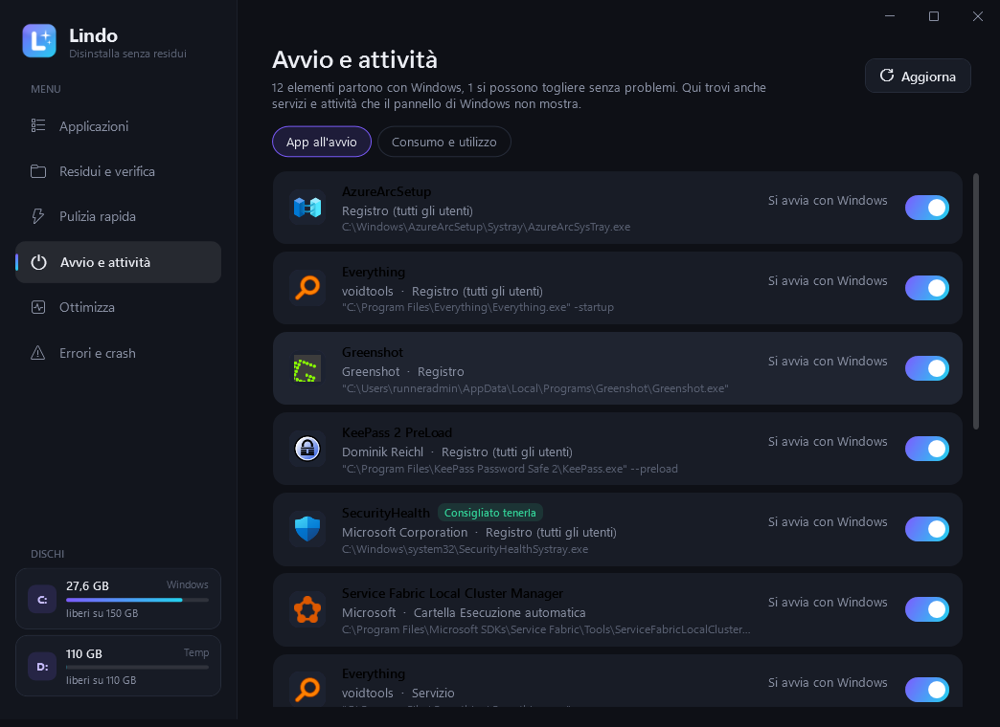
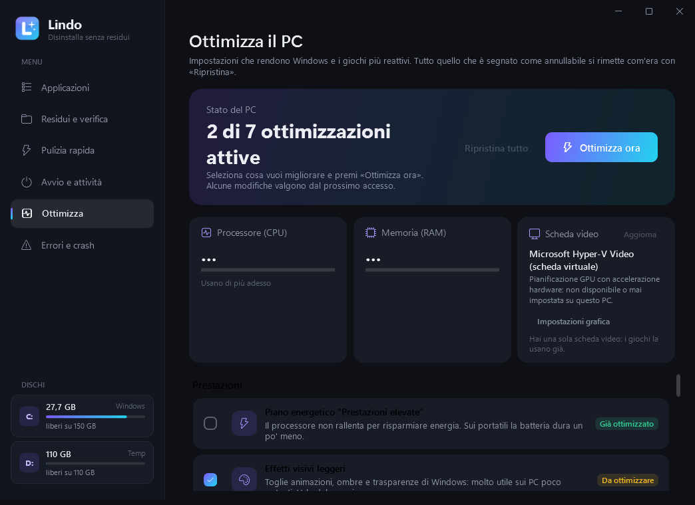
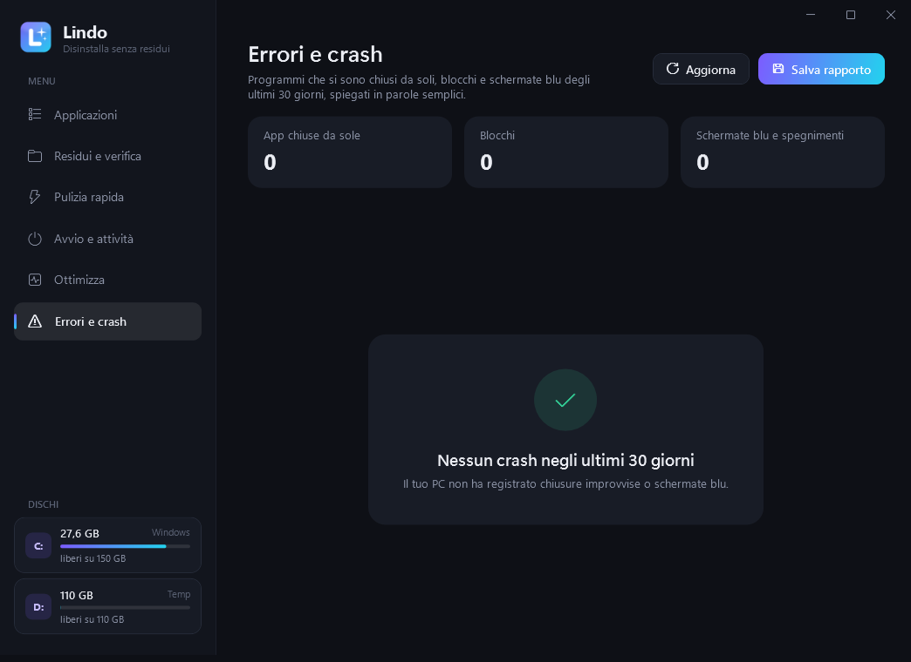
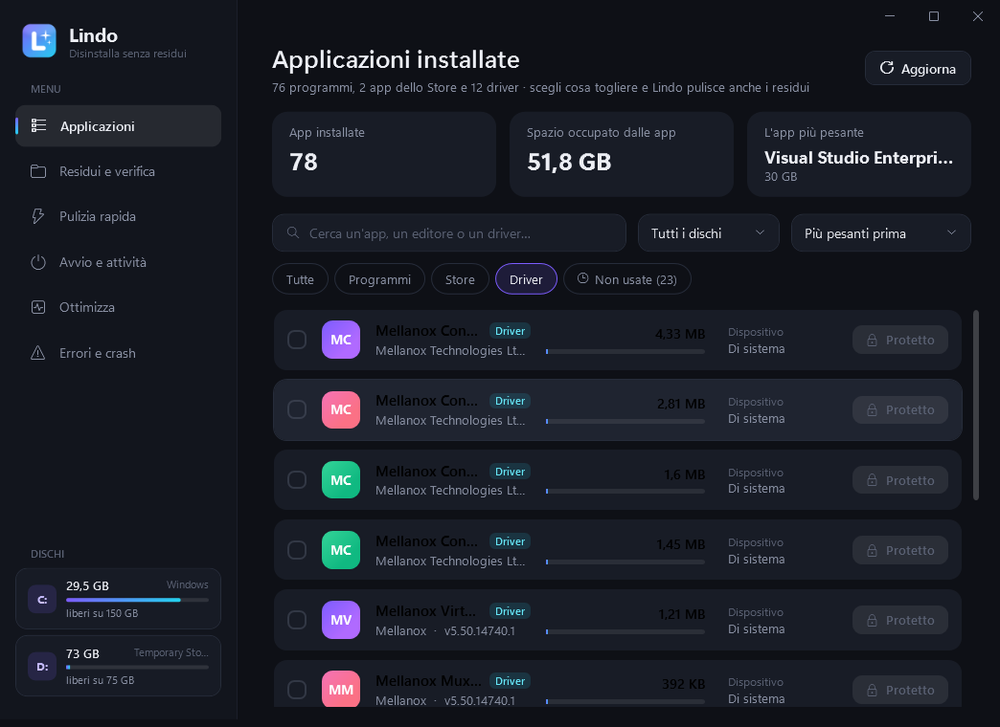

<p align="center">
  
</p>

<h1 align="center">Lindo</h1>

<p align="center">
  <b>Disinstalla le app di Windows senza lasciare residui.</b><br>
  Vedi quanto spazio occupa ogni app, la rimuovi con un clic e Lindo ripulisce anche le cartelle,<br>
  i collegamenti e le chiavi di registro che i programmi lasciano in giro.
</p>

<p align="center">
  
  
  
  
</p>

---

## Perché

Quando disinstalli un programma da Windows spesso restano cartelle in `Programmi`, `AppData`
e `ProgramData`, collegamenti rotti nel menu Start e voci nel registro. Su un disco quasi pieno
quei residui pesano. **Lindo** trova e rimuove tutto, senza toccare le altre app.

## Schermate

| Applicazioni installate | Conferma di disinstallazione |
|---|---|
|  |  |

| Residui e verifica | Pulizia rapida |
|---|---|
|  |  |

| Avvio e attività | Ottimizza |
|---|---|
|  |  |

| Errori e crash | Driver |
|---|---|
|  |  |

> Le schermate vengono scattate automaticamente su una vera macchina Windows dalla
> [CI di GitHub](.github/workflows/build.yml), dopo averci installato più di 20 programmi veri.

## Cosa fa

### 📦 Applicazioni
- Tutti i **programmi**, le **app dello Store** e i **driver** installati, con icona, editore, versione e
  **spazio realmente occupato** (misurato sul disco). Ordina per peso, nome, data o **"Meno usate prima"**.
- **Ultimo uso** di ogni app (dai dati di Windows e dal monitor di Lindo) e filtro **"Non usate"**:
  app installate da più di un mese e non aperte da almeno due.
- **Disinstallazione multipla**: spunta più app e toglile tutte insieme.
- **Più dischi**: nella barra laterale trovi tutti i dischi (C:, D:, E:…) con lo spazio libero; cliccane uno per
  vedere solo le app installate lì.

### 🧹 Disinstallazione completa
1. Avvia il disinstallatore **ufficiale** dell'app (o la rimozione di Windows per lo Store, o `pnputil` per i driver).
2. Cerca i residui: cartella di installazione, `AppData` / `ProgramData`, cartelle dei programmi sugli altri dischi,
   collegamenti nel menu Start e sul Desktop, chiavi di registro e la voce rimasta nell'elenco.
3. Cerca anche i **driver collegati** (es. stampante o scanner dello stesso produttore) e ti chiede
   *"Vuoi eliminare anche i driver?"*.
4. **Verifica finale**: ricontrolla il PC e ti dice cosa è stato eliminato e quanto spazio hai liberato.

### 🔍 Residui e verifica
Trova le cartelle lasciate da programmi già disinstallati su **tutti i dischi** e le voci "fantasma" nell'elenco app,
divise in **Sicuri da eliminare** e **Da controllare** (vedi la sezione Sicurezza).

### ⚡ Pulizia rapida
File temporanei, cestino (di tutti i dischi), cache delle miniature, rapporti di errore e file di Windows Update.

### 🚀 Avvio e attività
- Tutto quello che parte con Windows: chiavi di registro, cartella Esecuzione automatica, **servizi** e **attività pianificate**
  di terze parti (es. FortiClient VPN), anche quelli che il pannello di Windows non mostra. Ogni voce ha un interruttore.
  I servizi vengono messi in *avvio manuale* (partono solo quando servono) e si possono rimettere come prima.
- **Monitoraggio in background** (facoltativo): `LindoMonitor.exe` guarda ogni 30 secondi quali programmi sono aperti e
  registra tempo di utilizzo, CPU e memoria. I dati restano sul PC (`%LOCALAPPDATA%\Lindo\usage.tsv`).

### 🎮 Ottimizza
Un pulsante, tutto **annullabile** con "Ripristina tutto":
- piano energetico *Prestazioni elevate*;
- niente registrazione in background di Xbox Game Bar, modalità gioco attiva;
- **accelerazione del mouse disattivata** e niente popup dei *Tasti permanenti* (Maiusc ×5) durante i giochi;
- effetti visivi leggeri (animazioni, ombre e trasparenze);
- togli dall'avvio le app inutili (launcher, aggiornatori, chat, VPN…) lasciando antivirus, driver, audio e touchpad;
- pulizia dei file temporanei.

In cima alla pagina, **CPU, RAM e scheda video in tempo reale**:
- uso del processore e della memoria e i programmi che ne consumano di più in questo momento
  (le schede di Chrome, per esempio, vengono sommate);
- nome della scheda video e stato della *pianificazione GPU con accelerazione hardware*: Lindo non la
  cambia da solo (i suoi effetti dipendono dal PC), ma apre la pagina giusta di Impostazioni → Grafica;
- se il PC ha **due schede video** (integrata + dedicata), il pulsante *Gioco sulla scheda dedicata…* fa usare
  a un gioco quella più potente, come la stessa opzione di Impostazioni. Anche questo si annulla con "Ripristina tutto".

### 🩺 Errori e crash
Legge dal Registro eventi di Windows i programmi chiusi all'improvviso, i blocchi, le **schermate blu** e gli
spegnimenti improvvisi degli ultimi 30 giorni, e li spiega in italiano con cosa fare
(es. *"il crash avviene nel driver NVIDIA: aggiorna il driver video"*). Puoi salvare un rapporto in un file.

## Sicurezza: come evita di cancellare altro

Ogni eliminazione passa da più controlli, scritti in modo prudente e verificati con test automatici
**e su Windows vero con più di 20 programmi installati**:

- **Solo nelle cartelle dei programmi**: `Programmi`, `Programmi (x86)`, `ProgramData`, `AppData`, menu Start, Desktop
  e le cartelle dei programmi sugli altri dischi. Mai in `Windows`, mai le radici dei dischi, mai Documenti, Download, Immagini…
- **Residui "sicuri" solo se nessun indizio dice il contrario**. Una cartella NON è mai sicura se:
  - appartiene a un'app installata o al suo editore (es. `Google` con dentro Chrome e Drive);
  - è nel `PATH` o in una variabile d'ambiente (npm, Python, Android SDK, Java…);
  - contiene un servizio, un programma all'avvio, un programma registrato o un programma **in esecuzione adesso**;
  - è la destinazione di un collegamento nel menu Start, sul Desktop o nella barra delle applicazioni;
  - è stata modificata negli ultimi 3 mesi o usata di recente secondo il monitor;
  - è di uno strumento noto che non compare tra le app (npm, pip, Claude Code, Docker, Git, VS Code, Steam…).
  
  Per questo **"Seleziona tutti i sicuri"** si può usare senza paura: gli altri restano in *Da controllare*.
- **Driver protetti**: video, rete, dischi, chipset, audio, USB, tastiera e mouse non si possono rimuovere.
- **Registro con copia di sicurezza**: prima di eliminare una chiave Lindo ne salva un backup `.reg` in
  `%LOCALAPPDATA%\Lindo\Backup registro` (doppio clic per ripristinarla). Le chiavi di sistema sono intoccabili.
- **Ottimizzazioni reversibili**: i valori originali sono salvati in `%LOCALAPPDATA%\Lindo\ottimizzazioni-originali.tsv`.
- Collegamenti simbolici e junction non vengono mai seguiti. Tutto viene annotato in `%LOCALAPPDATA%\Lindo\lindo.log`.

## Installazione

### ⬇️ Download

- **[Lindo-1.1.0.msi](../../raw/HEAD/download/Lindo-1.1.0.msi)**: installer (consigliato)
- **[Lindo-1.1.0-portatile.zip](../../raw/HEAD/download/Lindo-1.1.0-portatile.zip)**: versione portatile (Lindo + monitor)
- **[Lindo.exe](../../raw/HEAD/download/Lindo.exe)**: solo l'app, senza monitor in background

Gli stessi file sono anche nella pagina [Releases](../../releases/latest).

| File | Quando usarlo |
|---|---|
| `Lindo-x.y.z.msi` | Installazione classica: collegamenti nel menu Start e sul Desktop, compare tra le app installate. |
| `Lindo-x.y.z-portatile.zip` | Versione portatile completa: estrai e avvia `Lindo.exe`. |
| `Lindo.exe` | Solo l'app (senza il monitor in background). |

Lindo chiede i permessi di amministratore all'avvio: servono per disinstallare i programmi e pulire
`Programmi` e `ProgramData`.

**Requisiti:** Windows 10 (versione 1903 o successiva) o Windows 11. Usa .NET Framework 4.8, che è già
incluso in queste versioni di Windows ([Microsoft Learn](https://learn.microsoft.com/dotnet/framework/install/guide-for-developers)),
quindi non serve scaricare nient'altro e l'installer pesa meno di **500 KB**.

> Windows SmartScreen potrebbe mostrare "PC protetto da Windows" perché l'eseguibile non è firmato digitalmente:
> clicca **Ulteriori informazioni → Esegui comunque**.

## Compilare da soli

Serve il [.NET SDK 8](https://dotnet.microsoft.com/download) (quello ufficiale Microsoft) e, per l'MSI, `wixl`
(pacchetto `wixl` su Ubuntu/Debian). Funziona anche su Linux:

```bash
./build.sh
```

I file finiscono in `dist/`. Su Windows basta `dotnet build src/Lindo -c Release`.

Opzioni da riga di comando, utili per i test:

```bash
Lindo.exe --selftest report.txt      # legge app e residui reali, verifica le regole di sicurezza, NON elimina nulla
Lindo.exe --screenshot cartella      # salva le schermate dell'interfaccia e si chiude
Lindo.exe --safety-test report.txt --expect "C:\\cartella;..."   # verifica che tra i residui "sicuri" ci sia solo ciò che ci si aspetta
Lindo.exe --test-uninstall report.txt --apps "VLC;7-Zip"         # disinstalla davvero e controlla che il resto sia intatto
```

## Struttura del progetto

```
src/Lindo.Core/        logica pura (riconoscimento dei residui, regole di sicurezza) — testata
src/Lindo/             app WPF: interfaccia, lettura del registro, disinstallazione, pulizia, avvio, ottimizzazione, crash
src/Lindo.Monitor/     LindoMonitor.exe: monitor leggero dell'uso delle app (facoltativo)
tests/Lindo.Core.Tests test automatici (xUnit)
installer/Lindo.wxs    definizione dell'installer MSI
assets/                icona e logo (rigenerabili con assets/make_icon.py)
```
